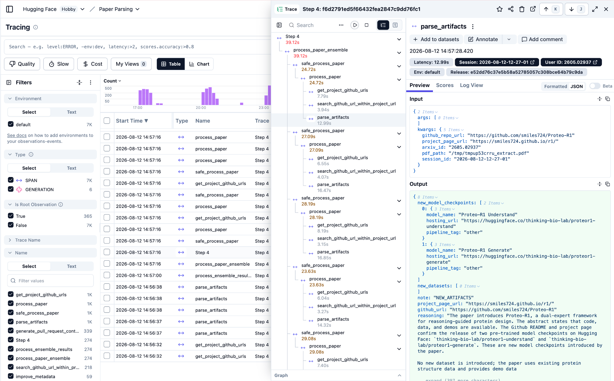

# Langfuse 使用：从 Trace 定位 Agent Badcase

Langfuse 是 LLM/Agent 的可观测与评测平台。它把一次请求中的模型调用、工具调用、检索和错误标记串成一条可展开的链路，便于回答“错在哪一步、怎么复现、改完是否变好”。下面的代码和页面示例是本地可复现演示；没有线上生产使用经历时，不应把它表述成线上维护经验。

## Q1. Langfuse 的 Trace 视图是什么？怎么用？

用户只说一句“帮我挑双便宜点的透气跑步鞋”，后台可能依次执行意图识别、抽槽、搜索、重排和答案生成。**Trace 是这一轮请求的完整链路；Observation 是链路中的节点。** 页面通常以树和时间轴展示它们：

- **Session**：同一用户的一段多轮会话；一个 Session 可以包含多个 Trace。
- **Trace**：一轮请求的生命周期。它把共享的 `trace_id`、`session_id` 等信息关联起来。
- **Observation**：Trace 中的观测节点。`Span` 记录业务步骤，`Generation` 记录一次 LLM 调用，`Event` 记录瞬时事件；工具调用和检索也可以作为节点记录。

Generation 里能看到哪些字段取决于 SDK、模型适配器和脱敏配置。常见字段包括模型名、输入摘要、结构化输出、token 用量、延迟和费用；不要默认记录或展示原始 Chain-of-Thought，线上更适合记录**结构化决策摘要、工具参数和错误类型**。

### 用 Trace 定位一个工具参数 Badcase

例如 Trace 展开后是：

```text
product-search
├─ planner (generation)
│  └─ decision_summary: "用户偏好低价、透气；类别=跑步鞋"
│     tool_call: {category: "跑步鞋", max_price: null}
├─ search_product_api (span)
│  └─ input: {category: "跑步鞋", max_price: null}
│     output: {items: [...], returned_count: 8}
└─ answer (generation)
   └─ output: "为你找到几双跑步鞋……"
```

先看 `planner` 的结构化摘要和工具参数，再看 `search_product_api` 的输入输出：如果“低价”被识别了，但 `max_price` 没传，搜索接口只是按收到的参数工作，责任边界就落在**意图到工具 Schema 的映射**，而不是搜索接口或最终话术。

### 一个最小可复现示例

当前 Python SDK 的基本流程是：设置环境变量、用 `start_as_current_observation` 创建嵌套观察、运行请求、`flush()` 发送短进程中的缓存。下面故意制造一个 `max_price: None` 的 Badcase：

```python
from langfuse import get_client, propagate_attributes

langfuse = get_client()  # 读取 LANGFUSE_* 环境变量

with langfuse.start_as_current_observation(
    as_type="span",
    name="product-search",
    input={"query": "帮我挑双便宜点的透气跑步鞋"},
) as root:
    with propagate_attributes(session_id="demo-session-001", user_id="demo-user"):
        with langfuse.start_as_current_observation(
            as_type="generation", name="planner", model="demo-planner"
        ) as planner:
            planner.update(output={
                "decision_summary": "低价 + 透气 + 跑步鞋",
                "tool_call": {"category": "跑步鞋", "max_price": None},
            })

        with langfuse.start_as_current_observation(
            as_type="span",
            name="search_product_api",
            input={"category": "跑步鞋", "max_price": None},
        ) as search:
            search.update(output={
                "items": [{"id": "shoe-101", "price": 999}],
                "returned_count": 1,
            })

        root.update(output={"status": "slot_missing"})
        langfuse.score_current_trace(
            name="error_type",
            value="slot_missing",
            data_type="CATEGORICAL",
            comment="低价意图未映射到工具参数",
        )

langfuse.flush()
```

运行后，Langfuse 中会出现一条 Trace 和三个嵌套 Observation；每条记录都有可关联的 ID、输入/输出、父子关系和时间信息。Generation 是否包含 token、费用等 usage 字段，取决于实际 LLM 集成是否上报。`score_current_trace` 会把 `error_type=slot_missing` 挂到这条 Trace 上。

接下来在界面里给这条 Trace 加标签或 Score，使用 **Add to Dataset** 保存输入、上下文和期望结果；修正 Schema 或 Prompt 后，用同一 Dataset 跑一次 Experiment，对比 `slot_missing` 比例、工具参数命中率和答案质量。Dataset/Experiment 的核心就是“测试样本 + 一次应用变体 + 评估器”，而不是把 Trace 当成模型训练数据直接喂进去。

### 从代码到 Web UI：两行接入

Langfuse 可以理解为“Python SDK + 浏览器里的可视化后台”。SDK 负责把函数层级、模型调用、工具输入输出、耗时和错误异步上报；Web UI 负责查看 Trace、筛选低分记录、人工标注和比较实验。它和 TensorBoard、W&B 的可观测部分相似，但数据模型专门面向 LLM / Agent。

当前 Python SDK 的装饰器入口是 `from langfuse import observe`，OpenAI 兼容调用可以使用 `from langfuse.openai import openai`。下面是一个最小接入示意；环境变量中的密钥和地址应放在本地环境或部署平台的 Secret 中：

```python
from langfuse import observe, propagate_attributes
from langfuse.openai import openai

@observe(name="run-ad-agent")
def run_ad_agent(user_query: str):
    with propagate_attributes(
        session_id="demo-session-001",
        user_id="demo-user",
        tags=["ad-agent"],
    ):
        planner = openai.chat.completions.create(
            model="qwen-2.5-72b",
            messages=[{"role": "user", "content": user_query}],
            tools=[search_product_tool_schema],  # 业务侧定义的工具 Schema
            name="planner",
        )
        # 这里继续执行搜索工具与答案生成；嵌套调用会出现在同一条 Trace 中。
        return build_final_answer(planner)

run_ad_agent("帮我挑双便宜点的透气跑步鞋")
```

`@observe()` 会把函数执行变成可展开的 Observation；Langfuse 的 OpenAI 包装器会记录模型调用的输入、输出、延迟和可用的 usage / cost 字段。旧版 SDK 的导入路径可能是 `langfuse.decorators`，面试或实际项目中要以当前锁定的 SDK 版本为准。

<figure class="langfuse-screenshot">

<figcaption>真实的 Langfuse Trace 界面示例：左侧可以筛选和查看追踪，中间展开嵌套 Observation，右侧查看输入、输出、耗时、Session、Score，并可执行 Add to datasets。Screenshot © Langfuse GmbH，图片来自 <a href="https://langfuse.com/docs/observability/overview" target="_blank" rel="noopener noreferrer">Langfuse 官方文档</a>。</figcaption>
</figure>

### Score 到底是谁打的？

Score 可以是数值，也可以是分类标签；关键是把评分来源和规则记录清楚。广告 Agent 中通常会组合三种方式：

| 打分方式 | 来源 | 广告 Agent 中的用法 |
| --- | --- | --- |
| 代码自动上报 | 后端规则、用户反馈或业务埋点 | 用户点“踩”、零召回、短点击等事件触发 `error_type=slot_missing` 或 `user_feedback=0`。 |
| 自动化裁判 | 已配置的 LLM-as-a-Judge / Evaluator | 按固定模板抽样检查价格幻觉、工具参数和答案完整性，再把结果作为 Trace 或 Experiment Score。 |
| 人工标注 | 算法工程师或标注员 | 在 Web UI 中打开低分 Trace，确认根因，选择 `slot_missing`、`wrong_category` 等标签并补充说明。 |

自动裁判不是“后台凭空知道答案”：它需要预先配置评估模板、采样规则和参考答案；人工分数也要保留标注规范，才能用于长期回归。

### Add to Dataset → Experiment：把线上错题变成回归集

看到“用户说要便宜跑步鞋，但 `max_price` 没传”的 Trace 后，可以在 Trace 详情页点击 **Add to datasets**：

1. 选择或新建 `Ad_Agent_Golden_Set`。
2. 保留原始 `Input`，把 `Expected Output` 补成可执行的正确结果，例如 `{"category": "跑步鞋", "price_preference": "low_budget"}`。
3. 保存后，这条真实错题就成为固定回归样本；以后改 Schema、Prompt 或模型时，用同一批输入重复运行。

当前 Python SDK 推荐让 Experiment Runner 负责逐条执行、追踪和绑定 Dataset Item。下面是一个更接近当前 SDK 的示意：

```python
from langfuse import get_client

langfuse = get_client()
dataset = langfuse.get_dataset("Ad_Agent_Golden_Set")

def run_v2(*, item, **kwargs):
    # item.input 是线上错题的原始输入；这里调用改过 Schema 的 Agent。
    return my_new_agent_v2(item.input)

result = dataset.run_experiment(
    name="v2_add_price_enum",
    description="Schema 增加 price_preference 后的回归评测",
    task=run_v2,
)
print(result.format())
```

Runner 会为每条样本创建实验 Trace，并把结果关联回 Dataset 和这次 Experiment；新版本不要再手写旧式 `item.link()`。实际项目还会配置 `slot_accuracy`、零召回率、答案质量等逐条 Evaluator，再在 Experiment 页面比较不同版本。下面的数字只是展示报表长什么样，不能当作本人的真实实验结果：

| 实验版本 | 槽位准确率（示意） | 平均耗时（示意） | 平均成本（示意） |
| --- | ---: | ---: | ---: |
| `v1_baseline` | 62.0% | 1.2 s | $0.002 |
| `v2_add_price_enum` | 88.5% | 1.1 s | $0.002 |
| `v3_grpo_finetuned` | 95.2% | 0.8 s | $0.001 |

面试时可以把闭环说成：**线上异常埋点 → Web UI 筛选低分 Trace → 人工确认根因并补 Ground Truth → Add to Dataset → 用新 Schema / Prompt / Checkpoint 跑 Experiment → 对比槽位准确率、延迟和成本**。如果没有真实线上 Langfuse 维护经历，应把“我们线上接入”改成“我做过本地可复现演示”，不要把示意报表说成线上数据。

## Q2. Think 识别出“便宜”，但没传 `max_price`，怎么解决？

这不是简单加一句 Prompt 的问题，而是**模糊偏好到精确 Schema 的映射失败**，还可能有“决策摘要到工具调用”的信息丢失。用户说“便宜”没有给出金额，模型若把 `max_price` 定义成必填数字，就可能选择留空，也可能猜一个错误数字。

### 第一层：先改 Schema，让表达能力匹配用户语言

保留明确数字使用的 `max_price: number`，另加模糊偏好字段，例如：

```json
{
  "price_preference": "low_budget",
  "sort_by": "price_asc",
  "max_price": null
}
```

后端再根据“跑步鞋”“羽绒服”等类目的价格分位规则，把 `low_budget` 转成可解释的价格带。明确说“300 元以内”时，才填 `max_price=300`。这样既避免瞎编数字，也保留了搜索策略。

### 第二层：把 Schema 说明和参数自检放在一起

在字段描述中写清楚：有明确数字就提取；只有“便宜、平价、学生党”等模糊偏好时，填 `price_preference`，不要猜金额。调用工具前，让模型输出一行结构化检查：

```text
价格原话：便宜点 → price_preference=low_budget, max_price=null
类别原话：跑步鞋 → category=跑步鞋
```

这里记录的是可审计的决策摘要，不需要保存原始思维链。这样可以直接检查“识别到的约束”和“实际发出的参数”是否一致。

### 第三层：用 Trace 数据做后训练和回归评测

从 Langfuse 中筛出“摘要里有低价意图、工具参数却为空”的轨迹：

1. 把原错误 Tool Call 作为 rejected；用规则、人工或独立模型补全后的调用作为 chosen，构造 DPO 样本。
2. 或在 GRPO 中增加一致性奖励：低价词命中且 `price_preference`、`max_price`、`sort_by` 全为空时惩罚；正确映射时奖励。
3. 每次改 Prompt、Schema 或模型，都在固定 Dataset 上对比参数命中率、零召回率和最终答案质量，避免只看总奖励上涨。

## 面试时怎么描述这段经历？

如果没有在线生产使用经历，可以这样说：

> “我没有把自己包装成线上 Langfuse 维护者，但我做过一个本地演示：每次请求创建 Trace，给 planner、搜索工具和回答生成分别记录 Generation/Span，记录输入摘要、工具参数、返回条数和耗时；再给 Trace 加 `slot_missing` Score，加入 Dataset，跑一次回归评测。我能解释 Trace、Observation、Score、Dataset 的关系；线上字段和 SDK 版本要以团队配置为准。”

这比声称“维护过线上 Langfuse”更稳。面试官继续追问时，直接展示上面的链路：**创建 Trace → 展开节点 → 找到漏传参数 → 打分 → 加入 Dataset → 对比修复前后指标**。

## 参考

- [Langfuse Python/JS SDK 概览](https://langfuse.com/docs/observability/sdk/overview)
- [OpenAI Python 集成与 `@observe()`](https://langfuse.com/integrations/model-providers/openai-py)
- [Experiments via SDK](https://langfuse.com/docs/evaluation/experiments/experiments-via-sdk)
- [Evaluate with Datasets](https://langfuse.com/docs/evaluation/get-started/offline)
- [Scores via SDK/API](https://langfuse.com/docs/evaluation/evaluation-methods/scores-via-sdk)
- [使用 Dataset 做离线评测](https://langfuse.com/docs/evaluation/get-started/offline)

